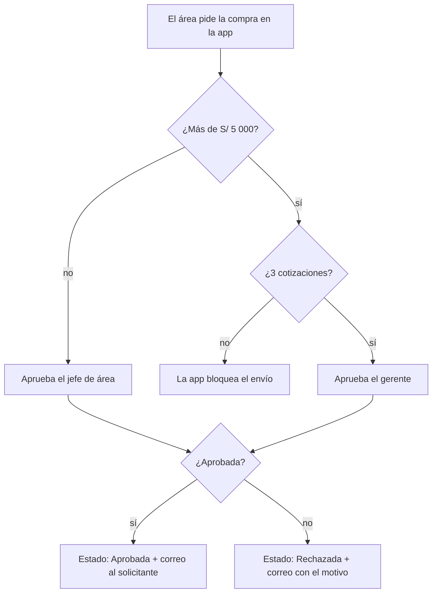
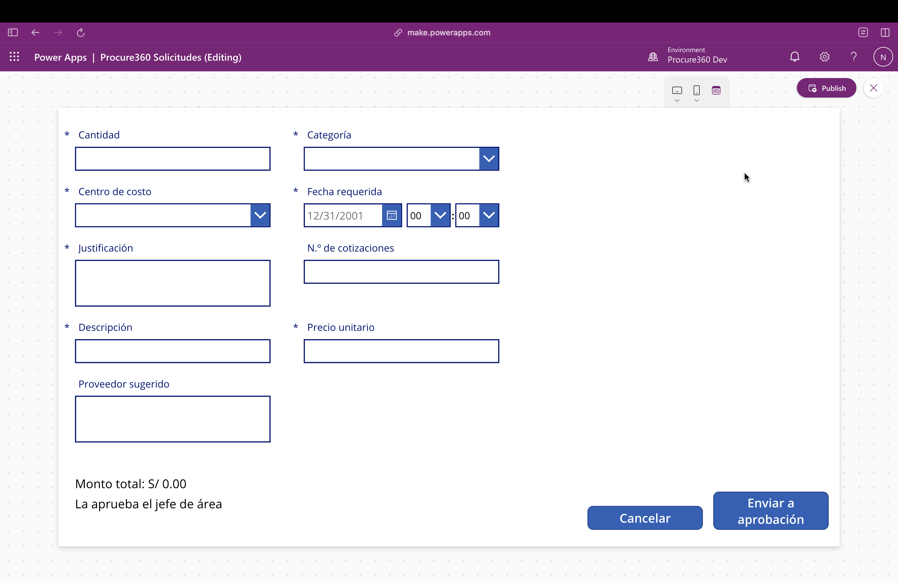
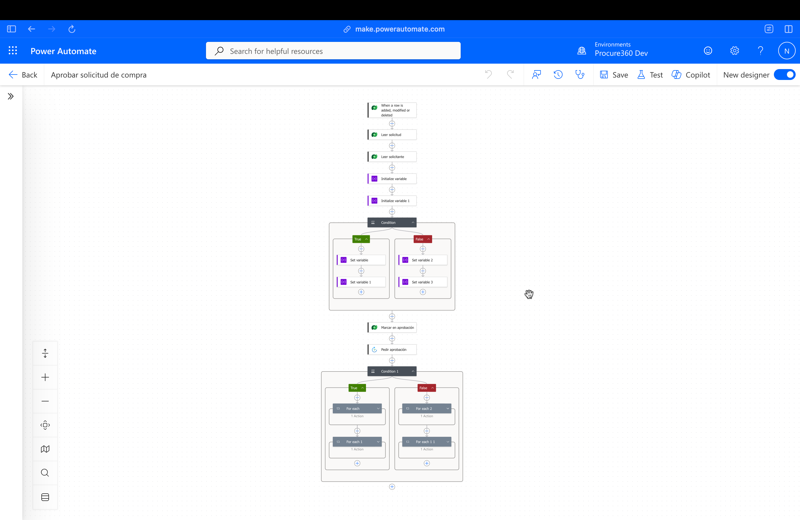
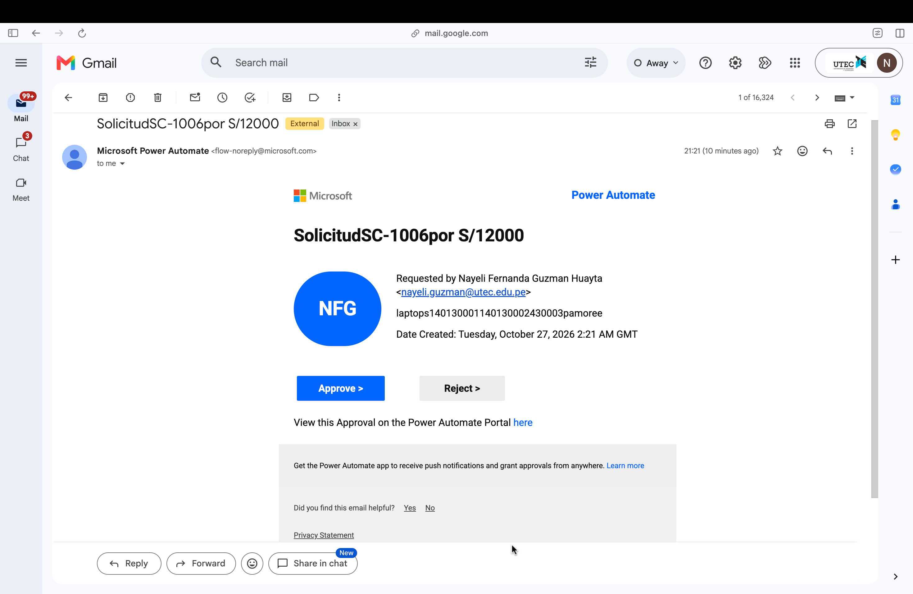

# Procure360 · Solicitudes de compra con aprobación automática

App en **Power Apps** + flujo en **Power Automate** + tabla en **Dataverse**. Reemplaza los pedidos de compra que llegan por correo o WhatsApp por un proceso ordenado, controlado y con registro.

---

## El problema

En muchas áreas de Compras las solicitudes llegan desordenadas:

- Cada área pide por un canal distinto y sin los mismos datos.
- Nadie sabe en qué estado está una solicitud.
- Una compra grande se puede aprobar sin comparar precios.
- Después no queda claro quién aprobó qué, ni por qué.

## La solución

1. **Una sola entrada.** Toda solicitud se registra en la app con descripción, categoría, centro de costo, cantidad, precio, fecha requerida y justificación.
2. **Control de precios.** Si el monto supera **S/ 5 000**, la app no deja enviar la solicitud hasta que tenga **3 cotizaciones**.
3. **Aprobación según el monto.** El flujo envía cada solicitud al aprobador que corresponde y espera su respuesta:
   - Hasta S/ 5 000 → **jefe de área**
   - Más de S/ 5 000 → **gerente**
4. **Trazabilidad.** Cada solicitud guarda su estado (*Pendiente → En aprobación → Aprobada / Rechazada*), quién la aprobó y su comentario. El solicitante recibe un correo con el resultado.

## Componentes

| Componente | Tecnología | Qué hace |
| --- | --- | --- |
| Tabla `Solicitud de compra` | Dataverse | 14 columnas: número automático (SC-xxxx), opciones, monto total calculado con fórmula, estado y aprobador |
| App `Procure360 Solicitudes` | Power Apps (app de lienzo) | Bandeja con todas las solicitudes y su estado en color, más un formulario con el monto en vivo y la validación de cotizaciones |
| Flujo `Aprobar solicitud de compra` | Power Automate | Se dispara al crear una solicitud, elige al aprobador, pide la aprobación, actualiza el estado y avisa por correo |

## Pruebas

| # | Caso | Resultado esperado | ✓ |
| --- | --- | --- | --- |
| 1 | 2 sillas × S/ 400 = S/ 800 | Aprueba el jefe, queda *Aprobada* y llega el correo | ✅ |
| 2 | Impresora de S/ 4 500, rechazada | Queda *Rechazada* y se guarda el comentario | ✅ |
| 3 | 4 laptops × S/ 3 000 con 1 cotización | La app bloquea el envío | ✅ |
| 4 | El mismo caso con 3 cotizaciones | La aprobación le llega al gerente | ✅ |
| 5 | Exactamente S/ 5 000 | Aprueba el jefe (el límite es "mayor que") | ✅ |

## Capturas

| Bandeja | Formulario con validación |
| --- | --- |
|  |  |

| Flujo en Power Automate | Aprobación recibida |
| --- | --- |
|  |  |

## Cómo importarlo

1. Descarga `solution/Procure360.zip`.
2. En [make.powerapps.com](https://make.powerapps.com): **Solutions → Import solution** → elige el `.zip`.
3. Al importar, conecta Dataverse, Approvals y Mail con tu cuenta.
4. En el flujo, cambia los correos del jefe y del gerente en las acciones *Set variable*.

> Los valores (umbral de S/ 5 000, 3 cotizaciones, niveles de aprobación) son de ejemplo. En una empresa se ajustarían a su política de compras.

## Próximos pasos

- **Dashboard de gasto en Power BI:** gasto por categoría y proveedor, concentración de proveedores y tiempos de aprobación.
- **Asistente en Copilot Studio:** responde preguntas sobre la política de compras y consulta el estado de una solicitud.

---

# procure360
