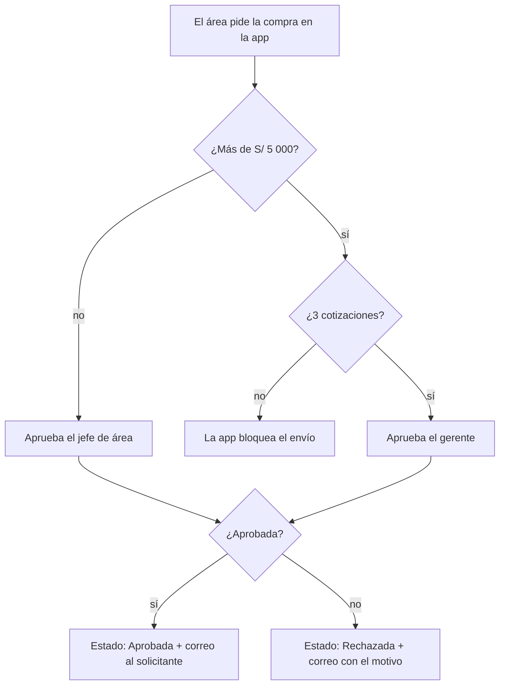
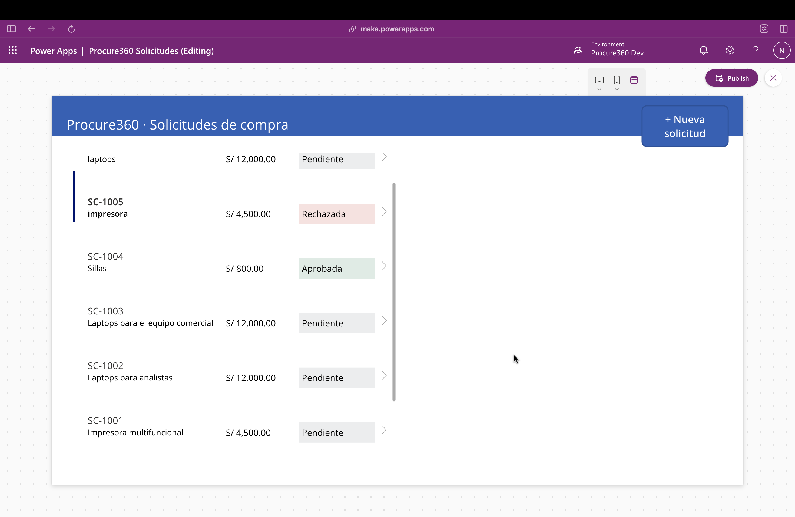

# Procure360 · Herramientas de datos y automatización para Compras

Dos proyectos que atacan problemas reales de un área de Compras:

1. **[Solicitudes de compra con aprobación automática](#1-solicitudes-de-compra-con-aprobación-automática)** — Power Apps + Power Automate + Dataverse
2. **[Dashboard de análisis de gasto](#2-dashboard-de-análisis-de-gasto)** — Power BI + DAX + Python, con 149 299 órdenes de compra reales del Estado peruano

---

## 1. Solicitudes de compra con aprobación automática


### El problema

- Cada área pide compras por un canal distinto y sin los mismos datos.
- Nadie sabe en qué estado está una solicitud.
- Una compra grande se puede aprobar sin comparar precios.
- Después no queda claro quién aprobó qué, ni por qué.

### La solución

1. **Una sola entrada:** toda solicitud se registra en la app con descripción, categoría, centro de costo, cantidad, precio, fecha requerida y justificación.
2. **Control de precios:** si el monto supera **S/ 5 000**, la app no deja enviar la solicitud hasta que tenga **3 cotizaciones**.
3. **Aprobación según el monto:** el flujo envía cada solicitud al aprobador correcto y espera su respuesta. Hasta S/ 5 000 aprueba el **jefe de área**; por encima, el **gerente**.
4. **Trazabilidad:** cada solicitud guarda su estado (*Pendiente → En aprobación → Aprobada / Rechazada*), quién la aprobó y su comentario. El solicitante recibe un correo con el resultado.



### Componentes

| Componente | Tecnología | Qué hace |
| --- | --- | --- |
| Tabla `Solicitud de compra` | Dataverse | 14 columnas: número automático, opciones, monto calculado con fórmula, estado y aprobador |
| App `Procure360 Solicitudes` | Power Apps (app de lienzo) | Bandeja con estados en color y formulario con monto en vivo y validación de cotizaciones |
| Flujo `Aprobar solicitud de compra` | Power Automate | Elige al aprobador según el monto, pide la aprobación, actualiza el estado y avisa por correo |

### Pruebas

| # | Caso | Resultado esperado | ✓ |
| --- | --- | --- | --- |
| 1 | 2 sillas × S/ 400 = S/ 800 | Aprueba el jefe, queda *Aprobada* y llega el correo | ✅ |
| 2 | Impresora de S/ 4 500, rechazada | Queda *Rechazada* y se guarda el comentario | ✅ |
| 3 | 4 laptops × S/ 3 000 con 1 cotización | La app bloquea el envío | ✅ |
| 4 | El mismo caso con 3 cotizaciones | La aprobación le llega al gerente | ✅ |
| 5 | Exactamente S/ 5 000 | Aprueba el jefe (el límite es "mayor que") | ✅ |

### Capturas

| Bandeja | Formulario con validación |
| --- | --- |
|  |  |

| Flujo en Power Automate | Aprobación recibida |
| --- | --- |
|  |  |

### Cómo importarlo

1. Descarga `solution/Procure360.zip`.
2. En [make.powerapps.com](https://make.powerapps.com): **Solutions → Import solution** → elige el `.zip`.
3. Conecta Dataverse, Approvals y Mail con tu cuenta.
4. En el flujo, cambia los correos del jefe y del gerente en las acciones *Set variable*.

> El umbral de S/ 5 000 y las 3 cotizaciones son valores de ejemplo; en una empresa se ajustan a su política de compras.

---

## 2. Dashboard de análisis de gasto

📄 **Reporte completo:** [`bi/Procure360_Gasto.pdf`](bi/Procure360_Gasto.pdf)

Análisis de **149 299 órdenes de compra** hechas en 2023 por 1 854 entidades del Estado peruano a 3 398 proveedores, a través de Perú Compras: **S/ 2 199 millones** en total.

### Hallazgos y propuestas

| # | Hallazgo | Propuesta |
| --- | --- | --- |
| 1 | El **80 % del gasto** se concentra en **448 proveedores** (13,2 % del total) | Priorizar a los proveedores clase A para negociar precios por volumen y acuerdos de nivel de servicio |
| 2 | La **Gran compra** es el 16 % de las órdenes pero mueve el **56,5 % del gasto**; en las 15 entidades que más gastan llega al 76 % | Agrupar necesidades de varias áreas en compras grandes para negociar mejores condiciones |
| 3 | La Marina de Guerra y el Ejército hacen más de 2 500 órdenes cada uno, con un ticket promedio **~35 % menor** que el promedio general (S/ 14 730) | Consolidar compras repetidas en menos órdenes para bajar el costo administrativo |
| 4 | El gasto se dispara en **noviembre** (cierre del año fiscal) y casi desaparece en agosto | Planificar las compras recurrentes durante el año; validar con la fuente si agosto está completo |

### Qué hay en el reporte

| Página | Contenido |
| --- | --- |
| Resumen | Gasto total, órdenes, proveedores, ticket promedio, tendencia mensual, top 10 entidades y gasto por tipo de compra |
| Proveedores ABC | Clasificación ABC, curva de Pareto del top 30 y ranking con la clase en color |
| Entidades | Matriz entidad × tipo de compra, dispersión órdenes vs. gasto y tabla de entidades |
| Hallazgos | Los 4 hallazgos con su propuesta |


### Cómo se hizo

1. **Datos:** órdenes de compra de Perú Compras en formato OCDS (5 tablas relacionadas por `main_ocid`).
2. **Preparación con Python** ([`bi/limpiar_peru_compras.py`](bi/limpiar_peru_compras.py)): une las tablas, filtra montos y fechas inválidos, calcula ranking, % acumulado y **clase ABC** de cada proveedor, y exporta un Excel con 3 tablas.
3. **Modelo en Power BI:** 3 tablas relacionadas (órdenes, proveedores, entidades) y 7 medidas DAX (gasto total, órdenes, proveedores, entidades, ticket promedio, % del gasto y % gasto clase A).
4. **Reporte:** 4 páginas construidas en el servicio web de Power BI.

### Cómo reproducirlo

```bash
# 1. Descarga "CSV · 2023" de https://data.open-contracting.org/en/publication/78 y descomprímelo
# 2. Instala dependencias y corre el script
python3 -m pip install pandas openpyxl
python3 bi/limpiar_peru_compras.py ruta/a/la/carpeta_con_los_csv
# 3. Sube procure360_bi.xlsx a OneDrive y conéctalo desde Power BI (Create → Excel)
```

**Datos:** [Open Contracting Partnership · Perú Compras](https://data.open-contracting.org/en/publication/78), licencia ODC-By. Son datos de compras públicas; la misma metodología aplica a los datos del ERP de una empresa.

---

## Estructura del repositorio

```
procure360/
├── README.md
├── solution/Procure360.zip        ← solución de Power Platform (app + flujo + tabla)
├── docs/                          ← capturas del proyecto 1
└── bi/
    ├── limpiar_peru_compras.py    ← preparación de datos
    ├── Procure360_Gasto.pdf       ← reporte exportado

```


